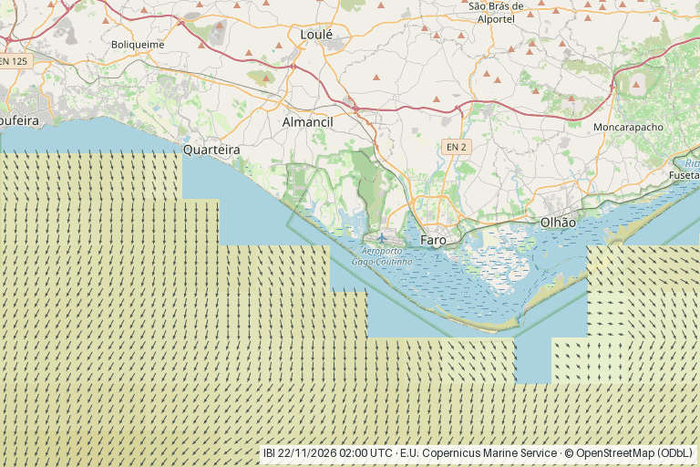
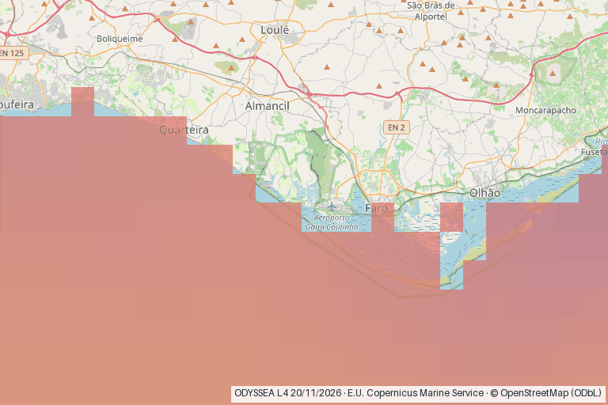

# Estudo — dinâmica do mar (correntes e temperatura da água) nos oito pesqueiros

**Data:** 21/11/2026. **Tipo:** estudo (PR 10 do plano de evolução). **Só documentação:** nada na app muda, nenhuma chamada a APIs foi acrescentada à app, o motor (`js/regras/`) não é tocado. Uma integração (PR 11) só acontece se este estudo mostrar uma fonte adequada **e** o utilizador a aprovar.

Convenções deste documento:
- **verificado** — visto numa resposta real a 21/11/2026, feita a partir do ambiente do Claude Code;
- **pela pesquisa** — lido em resultados de pesquisa na web, não na página original (os sítios de documentação estão bloqueados neste ambiente; ver §9);
- **por confirmar** — não foi possível verificar; não usar sem confirmação.

---

## 1. Resumo

- **Nenhuma fonte de correntes ou de temperatura chega aos pesqueiros.** Em todos os modelos, os pontos de pesca caem em células de terra; a primeira célula de mar fica a **2,3–8,2 km** (Open-Meteo), **2,4–7,0 km** (IBI, Copernicus) ou **3,8–7,0 km** (HYCOM, IH), com **24–37 m de fundo** no modelo IBI. A zona de rebentação, as correntes junto à praia e a **Ria Formosa** não estão representadas em nenhuma.
- **Correntes**: o melhor candidato é o **IBI físico do Copernicus** (1/36°, ~3 km, horário e de 15 em 15 min, com maré, 10 dias de previsão, mosaicos de mapa com setas desenhadas no servidor, CORS aberto, sem conta). Ao largo de Quarteira dá correntes de **0,02–0,15 m/s** dominadas pela maré. Serve como **contexto do largo**, não como valor do pesqueiro.
- **Correntes observadas**: a rede de radares HF **HFR-South** (IH e Puertos del Estado) existe e publica vectores horários, mas o radar de **VRSA está inoperacional** (lista do próprio IH) e a cobertura real entre Faro e Quarteira **não foi possível verificar** daqui. **Testar mais.**
- **Temperatura da superfície**: a análise de satélite **ODYSSEA L4 (0,02°, diária)** tem um píxel com valor a **0,4–2,6 km** dos pontos, com um erro estimado de **±0,55–0,59 K**. É uma **estimativa de satélite para um quadrado de ~2 km** (interpolada quando há nuvens), não previsão e **não é medição no pesqueiro**; chega com **um dia de atraso**. Boa candidata a **camada de mapa**.
- **Open-Meteo** (o que a app já usa para as ondas): também tem correntes e temperatura (indício forte de que vêm do SMOC/modelo global de 1/12°, ver §2.4 e §4.2), mas numa grelha de ~9 km em que **cinco pesqueiros partilham a mesma célula**. Não acrescenta resolução.
- **Recomendação** (§8): **não integrar já.** Primeiro, um **ensaio curto** (comparar IBI, ODYSSEA e Open-Meteo com a boia de Faro durante alguns dias, como no ensaio da validação) e **verificar a cobertura dos radares HF**. Se o utilizador quiser avançar depois, a proposta é uma camada **«Dinâmica do Mar»** no mapa, **só informativa**, que não entra nas notas.

### 1.1 Duas correntes diferentes

| | **Corrente ao largo** | **Corrente junto à praia** |
|---|---|---|
| O que é | Circulação da plataforma e corrente de maré, a 2–10 km da costa | Corrente longilitoral, agueiros (correntes de retorno), refluxo da rebentação, corrente de maré nos bicos das barras |
| O que a move | Maré, vento, circulação regional | Sobretudo a rebentação das ondas e a forma do fundo, numa escala de dezenas a centenas de metros |
| Quem a dá | Os produtos deste estudo (IBI, SMOC/Open-Meteo, HYCOM; os radares HF, se cobrirem a zona) | **Nenhum** dos produtos avaliados |
| Uso possível na app | Contexto do largo, sempre identificado como tal | — |

A corrente junto à praia **não se deduz** da corrente ao largo: podem ter sentidos e intensidades diferentes. Em todo o documento, «corrente» sem mais é a corrente **ao largo** que os produtos dão.

---

## 2. Fontes avaliadas

### 2.0 Quadro síntese

| Fonte | Fornecedor | Variáveis (unidade) | Resolução espacial | Resolução temporal | Nível | Horizonte | Actualização / latência | Acesso | Licença / custo |
|---|---|---|---|---|---|---|---|---|---|
| **IBI_ANALYSISFORECAST_PHY_005_001** (modelo) | Copernicus Marine (IBI-MFC) | `uo`, `vo` (m s-1), `thetao` (degrees_C), `zos`, … | 0,027° (1/36°, ~3 km) — verificado no nome do conjunto | horário (média), 15 min (instantâneo, `uo`/`vo`/`zos`), diário sem maré | superfície (2D); 3D com níveis de −0,494 m a −5728 m | até 30/11 23:00 a 21/11 (~10 dias) — verificado | camada actualizada a 21/11 às 10:03 UTC — verificado; «diária, 14:00 UTC» pela pesquisa | WMTS (mosaicos e GetFeatureInfo), sem conta — verificado | grátis, com atribuição (licença Copernicus Marine, pela pesquisa) |
| **GLOBAL_ANALYSISFORECAST_PHY_001_024** (modelo) e **SMOC** | Copernicus Marine (Mercator Ocean) | `uo`, `vo`, `thetao`; SMOC: `utotal`/`vtotal` (euleriana + ondas + maré), `utide`/`vtide`, `vsdx`/`vsdy` (deriva de Stokes) | 1/12° (~9 km) | horário | superfície (−0,494 m) | até 30/11 — verificado | camadas de 21/11 03:25 e 09:57 UTC — verificado | WMTS, sem conta | idem |
| **SST_ATL_SST_L4_NRT_OBSERVATIONS_010_025** (ODYSSEA, satélite) | Copernicus Marine (Ifremer) | `analysed_sst` (kelvin), `analysis_error` (kelvin) | 0,02° (~2 km) | diária | superfície (pele/fundação: por confirmar no manual) | — (observação) | último dia: 20/11, publicado a 21/11 às 07:19 UTC — verificado | WMTS, sem conta | idem |
| **SST_GLO_SST_L4_NRT_OBSERVATIONS_010_001** (OSTIA, satélite) | Copernicus Marine (Met Office) | `analysed_sst`, `analysis_error` (kelvin) | 0,05° (~5 km) | diária | superfície | — | último dia 20/11, publicado 21/11 07:17 UTC — verificado | WMTS | idem |
| **SST_ATL_PHY_L3S_NRT_010_037** (satélite, sem preenchimento) | Copernicus Marine | `sea_surface_temperature`, `adjusted_…` (K) | 0,02°/0,05° (por confirmar) | diária | fundação (título da camada) | — | 20/11 publicado 21/11 07:11 UTC — verificado | WMTS | idem |
| **Open-Meteo Marine** | Open-Meteo (dados `meteofrance_currents`) | `ocean_current_velocity` (km/h), `ocean_current_direction` (°), `sea_surface_temperature` (°C) | grelha de 1/12° (centros a x,0417°) — verificado | horário — verificado (metadados: 3600 s) | superfície | até 30/11 23:00 (correntes) e 01/12 05:00 (temperatura) — verificado | uma corrida por dia: 00 UTC, disponível às 12:05 UTC — verificado (metadados) | API JSON, sem chave — verificado | a mesma do Open-Meteo que a app já usa (ver `fontes.html`) |
| **HYCOM** (IH, OGC API EDR) | Instituto Hidrográfico | `u`, `v` (m/s), `sst` (K), `sss` | ~0,018° × 0,022° (~2 km), inferido das coordenadas devolvidas | 3 h — verificado | superfície | 7 dias — verificado | «corrida diária mais recente» (descrição da colecção) | EDR `position`/`cube`, CORS — verificado | **CC BY 4.0** — verificado (ligação da colecção) |
| **HFR-South** (radares HF, observação) | IH e Puertos del Estado; processamento EU HFR Node (pela pesquisa) | corrente de superfície total (u, v) | por confirmar | horária (ficheiros horários, pela pesquisa) | primeiros decímetros de água (por confirmar) | — (observação) | quase tempo real (pela pesquisa) | EMODnet Physics ERDDAP (`EUHFR_NRTcurrent_HFR-South-Total`, pela pesquisa) — **bloqueado neste ambiente** | colecção do IH: **CC BY 4.0** — verificado |
| **IPMA**, previsão diária do estado do mar | IPMA | `sstMin`/`sstMax` (°C), por local | um ponto (Faro, `globalIdLocal 1080526`) | diária | superfície | 3 dias | — | API JSON | termos do IPMA (CLAUDE.md §9) |

O IPMA não tem correntes. A previsão diária do estado do mar já foi avaliada e retirada da app a 20/11/2026 (decisão do utilizador); fica aqui só para completar o quadro.

### 2.1 Copernicus IBI (modelo físico regional)

- **Produto:** `IBI_ANALYSISFORECAST_PHY_005_001`, conjuntos `cmems_mod_ibi_phy_anfc_0.027deg-2D_PT1H-m_202411` (horário, médias), `…-2D_PT15M-i_202411` (15 min, instantâneo), `cmems_mod_ibi_phy-cur_anfc_detided-0.027deg_P1D-m_202411` (média diária **sem maré**), `…-3D_PT1H-m_202506` (3D horário). **Verificado** nas capacidades WMTS.
- **Modelo:** NEMO a 1/36° com 50 níveis; inclui maré, sobreelevação, rios e ondas; 10 dias de previsão, actualizado diariamente. **Pela pesquisa.**
- **Fundo do modelo** (camada `deptho`) nas primeiras células de mar junto aos pesqueiros: **24–37 m** (verificado). Ou seja, a «costa» do modelo é a isóbata dos ~25–35 m. A imagem do §4.4 mostra a máscara de terra em degraus.
- **Unidades:** `uo`/`vo` em m s-1, `thetao` em degrees_C (verificado). As velocidades vêm com três casas decimais.
- **Direcção:** calcula-se de `uo` (para leste) e `vo` (para norte). É a direcção **para onde vai** a água (convenção oceanográfica), ao contrário do vento («de onde vem»).

### 2.2 Copernicus GLOBAL e SMOC

- **Produto:** `GLOBAL_ANALYSISFORECAST_PHY_001_024`; 1/12°, 10 dias, actualizado diariamente (pela pesquisa; o horizonte até 30/11 foi verificado).
- **SMOC** (`cmems_mod_glo_phy_anfc_merged-uv_PT1H-i_202211`): `utotal` está descrito como «Eastward total velocity (Eulerian + Waves + Tide)» (verificado no título da camada). Junta o modelo global 1/12°, o modelo de ondas global e o modelo de maré FES (pela pesquisa).
- Junto à costa, a célula de 1/12° cobre vários pesqueiros (§3).

### 2.3 Temperatura por satélite (ODYSSEA L4, OSTIA L4, L3S)

- **ODYSSEA L4** (`SST_ATL_SST_L4_NRT_OBSERVATIONS_010_025`): análise diária **sem lacunas** de vários satélites (infravermelho e micro-ondas), 0,02°, área 9–62° N, 21° W–13° E (pela pesquisa: manual do produto). A variável `analysis_error` dá o erro estimado de cada píxel (verificado: 0,55–0,59 K junto aos pesqueiros a 20/11).
- **OSTIA L4**: 0,05°, global, erro estimado 0,34–1,03 K junto aos pesqueiros (verificado).
- **L3S** (sem preenchimento): só tem píxeis onde o satélite viu o mar sem nuvens. A 20/11 deu **16,37 °C** junto a Quarteira, contra 18,6–18,7 °C das análises L4 no mesmo dia. Pode ser contaminação junto à costa ou nuvens (**não verificado**). Por isso o L3S não serve para valores junto à costa sem controlo de qualidade próprio.
- **«Sem lacunas» quer dizer interpolado:** com nuvens, o L4 preenche com o que os dias e os píxeis vizinhos indicam. Não é uma medição naquele píxel naquele dia.

### 2.4 Open-Meteo Marine

- Variáveis `ocean_current_velocity` (**km/h**), `ocean_current_direction` (°) e `sea_surface_temperature` (°C) (verificado).
- **Modelo:**
  - os metadados da API identificam o conjunto como `meteofrance_currents`, horário (3600 s), uma corrida por dia (00 UTC, disponível às 12:05 UTC), até 01/12 (verificado em `/data/meteofrance_currents/static/meta.json`);
  - a documentação diz, pela pesquisa: «Velocity of ocean current considering Eulerian, Waves and Tides» e «MeteoFrance SMOC Currents, Tides» a 0,08°.
- **Direcção:**
  - a documentação não foi lida (anfitrião bloqueado);
  - na comparação do §4.2, o Open-Meteo coincide com o SMOC total do Copernicus quando a direcção é calculada como «para onde vai» (diferenças de 0–6°).
  - Conclusão provisória: `ocean_current_direction` é **para onde vai** a corrente. **Confirmar na documentação antes de usar.**
- **Grelha:** a mesma das ondas (centros em x,0417°): cinco pesqueiros (Forte Novo, molhe de Quarteira, praia e molhe de Vilamoura, Falésia) partilham a célula 37,042 / −8,125 (verificado).
- **Valor suspeito:** nessa célula, a 22/11, de 12:00 a 22:00 UTC (amostras de 2 em 2 h), a direcção ficou em **90° fixos** e a velocidade em 0,4–0,7 km/h, enquanto o SMOC variava. Pode ser um efeito de célula junto à costa. **Não explicado.**

### 2.5 HYCOM do Instituto Hidrográfico

- Colecção `hycom` da OGC API EDR (`/collections/hycom/position`), com `u`, `v` (m/s, «positive values indicate eastward/northward flow»), `sst` (K) e `sss`. Resolução de 3 h, 7 dias, «corrida diária mais recente» (verificado na descrição da colecção).
- Nos pontos de pesca, o servidor responde **HTTP 500** (células de terra; a 20/11/2026 devolvia −1×10³⁴). A primeira célula de mar fica a **3,8–7,0 km** (verificado).
- Licença **CC BY 4.0** (verificado na ligação da colecção).

### 2.6 Radares HF (HFR-South)

Na OGC API do IH (verificado):
- colecção `hfr_south`, rede HFR-South desde 2012, DOI 10.57762/RNCF-D423, licença CC BY 4.0;
- colecção `hfr_stations`, com quatro estações nesta rede:

| Estação | Local (lon., lat.) | Frequência | Entidade | Estado (IH) |
|---|---|---|---|---|
| SGTR | −8,949, 36,994 (Sagres) | 13,5 MHz | IH | operacional |
| AFTR | −8,443, 37,087 (Alfanzina) | 13,5 MHz | IH | operacional |
| VATR | −7,444, 37,179 (VRSA) | 13,5 MHz | IH | **inoperacional** |
| MAZA | −6,83, 37,13 (Mazagón) | 13,5 MHz | Puertos del Estado | operacional |

- Uma corrente **total** (u, v) precisa de pelo menos dois radares a ver o mesmo ponto. Com VRSA parado:
  - Faro–Quarteira fica a ~30–50 km de Alfanzina e a ~100–120 km de Mazagón;
  - o alcance real a 13,5 MHz e a cobertura dos vectores totais nesta zona **ficam por confirmar** (o polígono publicado pelo IH é só o rectângulo −9,6…−6,2 / 36,0…37,2, que não diz nada sobre a cobertura).
- Os dados horários de corrente total estão no EMODnet Physics ERDDAP (`EUHFR_NRTcurrent_HFR-South-Total`, pela pesquisa); o anfitrião está **bloqueado neste ambiente**.
- Um estudo publicado usa 4,5 anos destes radares no norte do golfo de Cádis (pela pesquisa: de Oliveira Júnior, Relvas e Garel, *Ocean Science* 18, 2022). Conclusões:
  - na plataforma as correntes são sobretudo paralelas à costa;
  - a circulação do talude inverte-se com Levante forte (> ~10 m/s).

  Isto confirma que a rede mede a região, não que meça junto aos pesqueiros.

---

## 3. Cobertura dos oito pesqueiros

Distância do ponto de dados de cada pesqueiro (config) à primeira célula com valor, a 21–22/11/2026. «Partilhada» = a mesma célula serve outros pesqueiros. No IBI e no HYCOM, a procura foi feita **só para sul** (o mar fica a sul em toda esta costa), de 0,01° em 0,01° (IBI) e de 0,005° em 0,005° (HYCOM): as distâncias são **máximos**; outra direcção podia dar uma célula um pouco mais perto.

| Pesqueiro (ponto) | Open-Meteo (correntes e temperatura) | IBI físico (correntes e temperatura) | HYCOM IH | ODYSSEA L4 (temperatura; píxel mais próximo) |
|---|---|---|---|---|
| 1 Ria Formosa (água: `faroMar` 36,97 / −7,98) | 2,3 km, célula do mar de fora | 3,1 km, mar de fora | não testado | não testado |
| 2 Praia de Faro (`faroMarPoente`) | 6,9 km (partilhada com 3) | 4,7 km | 5,5 km | 0,5 km |
| 3 Ancão (`ancaoPraia`) | 8,2 km (partilhada com 2) | 3,8 km | 3,8 km | 2,6 km |
| 4 Almargem (`forteNovo`) | 3,8 km (partilhada com 5–8) | 7,0 km | 7,0 km | 1,3 km |
| 5 Molhe de Quarteira | 3,1 km (partilhada) | 4,4 km (partilhada com 6 e 7) | 5,6 km (partilhada com 6) | 0,4 km |
| 6 Praia de Vilamoura | 3,4 km (partilhada) | 5,1 km (partilhada) | 6,2 km (partilhada) | 1,0 km |
| 7 Molhe de Vilamoura | 3,1 km (partilhada) | 4,9 km (partilhada) | não testado | não testado |
| 8 Falésia (`falesiaMar`) | 4,8 km (partilhada) | 2,4 km | 4,5 km | 1,0 km |

As distâncias do ODYSSEA são do **píxel de satélite mais próximo** (~2 km de lado): um valor desse píxel é uma estimativa de satélite para essa área, não uma medição no pesqueiro.

O que isto quer dizer:
- **Resolução:**
  - nenhum modelo distingue os pesqueiros de Quarteira a Vilamoura;
  - o Open-Meteo junta cinco deles numa célula, o IBI três;
  - o ODYSSEA distingue mais (0,02°), mas a interpolação junto à costa e os píxeis sobre terra (§4.4) tiram-lhe precisão local.
- **Célula longe da costa:** as primeiras células de mar ficam onde o fundo tem 24–37 m. Uma corrente a 3–7 km da praia não é a corrente na beira-mar.
- **Zona de rebentação:** as correntes que importam ao surfcasting fazem-se dentro da rebentação e **não estão em nenhum destes produtos**:
  - correntes longilitorais;
  - agueiros (correntes de retorno);
  - correntes de maré junto aos bicos das barras.

  O SMOC inclui a deriva de Stokes das ondas ao largo, que não é a mesma coisa.
- **Ria Formosa:** não existe em nenhum modelo nem como água em nenhum produto de satélite usado. As correntes de maré nos canais e nas barras não são representadas.
- **Interpolação:** escolher «a célula mais próxima» ou interpolar para a praia seria **extrapolar** para onde o modelo não tem água. A app não o deve fazer (CLAUDE.md §1: nunca estimar).
- **Dados desactualizados:** o ODYSSEA chega com um dia de atraso (20/11 publicado a 21/11). As previsões são de uma corrida por dia. Qualquer valor mostrado tem de levar a data do dado e a hora da leitura (critério 10).
- **Valores em falta:** fora das células de mar, as fontes devolvem nada (WMTS: `value` nulo), erro (HYCOM: HTTP 500) ou nulos (Open-Meteo, para lá do horizonte). Todos têm de aparecer como «não obtido».

---

## 4. Exemplos reais

### 4.1 Correntes do IBI ao largo de Quarteira (22/11/2026, previsão de 21/11)

Célula 37,027 / −8,110: a célula de mar mais próxima do molhe de Quarteira e dos dois pontos de Vilamoura, a 4,4–5,1 km deles (corrente **ao largo**, não junto à praia). Média horária de superfície. «Para» = direcção para onde vai a água.

| Hora (UTC) | Velocidade (m/s) | Para | Temperatura (°C) |
|---|---|---|---|
| 00:00 | 0,140 | 166° (SSE) | 19,05 |
| 02:00 | 0,145 | 178° (S) | 19,01 |
| 04:00 | 0,107 | 189° (S) | 18,98 |
| 06:00 | 0,058 | 203° (SSO) | 18,95 |
| 08:00 | 0,023 | 247° (OSO) | 18,93 |
| 10:00 | 0,016 | 284° (ONO) | 18,96 |
| 12:00 | 0,023 | 223° (SO) | 19,05 |
| 14:00 | 0,040 | 193° (SSO) | 19,14 |
| 16:00 | 0,047 | 175° (S) | 19,10 |
| 18:00 | 0,044 | 162° (SSE) | 19,01 |
| 20:00 | 0,036 | 132° (SE) | 18,97 |
| 22:00 | 0,035 | 121° (ESE) | 18,95 |

Média diária **sem maré** (`uo_detided`/`vo_detided`, 22/11): 0,043 m/s para 171°. A corrente desta célula é fraca (até ~0,15 m/s ≈ 0,5 km/h) e roda com a maré.

### 4.2 Open-Meteo e SMOC no mesmo sítio (célula da boia de Faro, 22/11/2026; amostra de um dia)

| Hora (UTC) | Open-Meteo km/h | Open-Meteo direcção | SMOC total km/h | SMOC total «para» | SMOC só euleriana km/h | Open-Meteo °C | Global 1/12° °C |
|---|---|---|---|---|---|---|---|
| 00:00 | 1,5 | 97° | 1,42 | 95° | 1,11 | 19,6 | 19,55 |
| 06:00 | 0,6 | 72° | 0,66 | 69° | 0,53 | 19,3 | 19,23 |
| 12:00 | 1,4 | 40° | 1,43 | 43° | 1,40 | 19,8 | 19,87 |
| 18:00 | 1,7 | 72° | 1,77 | 70° | 1,71 | 20,3 | 20,25 |

Interpretação:
- o Open-Meteo coincide com o **SMOC total** (corrente + ondas + maré) em velocidade (±0,1 km/h) e direcção (0–6°, nas 12 horas comparadas), e menos com a corrente só euleriana;
- a temperatura coincide com o modelo global.

É um indício de que ambos vêm do sistema global de 1/12°, **não** é prova. Junto a Quarteira a comparação não foi conclusiva: a célula do Copernicus devolvida não coincidiu com a do Open-Meteo.

### 4.3 Temperatura da superfície junto à boia de Faro (amostra, não validação)

A boia (IH, CC BY-NC 4.0) mede a ~6 km do Cabo de Santa Maria; os produtos usam a célula mais próxima.

| Fonte | 20/11 (média do dia) | 21/11 às 12:00 UTC |
|---|---|---|
| Boia de Faro, medida (QC 1–2) | 18,45 °C (17,4–18,9; 48 medições) | 18,8–18,9 °C (11:56 e 12:26) |
| ODYSSEA L4 (satélite, diária) | 18,92 °C (erro estimado 0,55 K) | — |
| OSTIA L4 (satélite, diária) | 18,49 °C (erro estimado 0,44 K; célula a 3,1 km) | — |
| L3S (satélite, sem preenchimento) | 18,48 °C | — |
| Open-Meteo (previsão) | 19,12 °C (média das 24 h) | 19,6 °C |
| IBI físico (previsão) | — | 20,28 °C |
| Global 1/12° (previsão) | — | 18,39 °C (célula a 2,1 km) |

**Uma amostra não é validação.** Serve só para mostrar que as fontes diferem entre si em 1–2 °C neste sítio e que nenhuma deve ser apresentada como «a temperatura da água no pesqueiro». A app já mostra a água do Open-Meteo (regra 7) e a da boia («Mar agora»); nada disso muda com este estudo.

### 4.4 Imagens (mosaicos reais do Copernicus Marine sobre o OpenStreetMap)

Correntes do IBI a 22/11/2026 às 02:00 UTC (setas desenhadas pelo serviço, estilo `cmap:speed,vectorStyle:solidAndVector`). A faixa de mar **sem setas** entre a costa e a malha é a máscara de terra do modelo; a Ria Formosa fica de fora:

Temperatura da superfície ODYSSEA L4 de 20/11/2026 (estilo `cmap:thermal`). A grelha de 0,02° chega à costa, mas há píxeis sobre terra (Quarteira, aeroporto, Ria). Com a escala de cores do serviço, as diferenças de décimas de grau quase não se vêem: um mapa útil para o utilizador precisaria de uma escala local (ver §6):

Créditos:
- Generated using E.U. Copernicus Marine Service Information:
  - `IBI_ANALYSISFORECAST_PHY_005_001`, conjunto `cmems_mod_ibi_phy_anfc_0.027deg-2D_PT1H-m_202411`, variável `sea_water_velocity`, média horária das 02:00 UTC de 22/11/2026 (previsão disponível a 21/11). DOI do produto: **por confirmar** (a página do produto está bloqueada neste ambiente; a pesquisa só encontrou o DOI da reanálise, que é outro produto).
  - `SST_ATL_SST_L4_NRT_OBSERVATIONS_010_025`, conjunto `IFREMER-ATL-SST-L4-NRT-OBS_FULL_TIME_SERIE_201904`, variável `analysed_sst`, dia 20/11/2026. DOI 10.48670/moi-00152 (pela pesquisa).
- Fundo: © OpenStreetMap; dados sob a licença ODbL, https://www.openstreetmap.org/copyright.
- Composição: seis mosaicos de cada fonte (nível 11, EPSG:3857), com as camadas do Copernicus sobrepostas com transparência (75 % e 70 %) e o crédito gravado no canto de cada imagem. Feita só para este documento.
- As cores são as do serviço, sem legenda: as imagens mostram formas e cobertura, **não servem para ler valores**.

---

## 5. O que estes dados podem e não podem dizer

**Podem:**
- mostrar o **padrão do largo**: para onde corre a água a 3–10 km da costa, como roda com a maré, se há um fluxo para leste ou para oeste ao longo da plataforma;
- mostrar **frentes de temperatura** e água mais fria ou mais quente numa escala de quilómetros (satélite, com um dia de atraso);
- ajudar a **perceber** o que se vê no terreno (água fria de repente, água turva a deslocar-se), sempre como contexto.

**Não podem:**
- dar a corrente na beira-mar, na rebentação, nos agueiros ou nos bicos das barras;
- dar a temperatura no pesqueiro (as fontes diferem 1–2 °C entre si ao largo de Faro);
- entrar nas notas. Isso exigiria uma regra nova e a aprovação do utilizador; este estudo **não propõe nenhuma**.

**Afloramento (upwelling), com prudência.** Na costa sul do Algarve, a literatura descreve episódios em que água mais fria aparece junto à costa, sobretudo a ocidente, ligados ao vento de Oeste/Noroeste e à água fria que vem do Cabo de São Vicente. Com Levante, descreve uma contracorrente costeira de água mais quente para oeste. O estudo de 2022 citado no §2.6 confirma (pela pesquisa) a inversão da circulação do talude com Levante forte.

Estes padrões são **regionais**. Uma camada de temperatura pode mostrar «água mais fria junto à costa a ocidente», mas a app não pode afirmar «há afloramento» nem tirar daí conclusões para a pesca sem uma regra validada no terreno. Se um dia se mostrar, o texto deve ser do tipo «Temperatura do satélite mais baixa junto à costa (−x °C em relação a 20 km ao largo, dado de DD/MM). Pode ser afloramento; não é medição no pesqueiro.»

---

## 6. Proposta de interface «Dinâmica do Mar» (só se o utilizador aprovar o PR 11)

**Onde.** No ecrã «Mapa» (`mapa.html`), um grupo de camadas «Dinâmica do Mar», desligado por omissão, com duas camadas:
1. **«Correntes (modelo IBI, ~3 km, previsão)»**: mosaicos WMTS com setas desenhadas pelo serviço (velocidade em cor, direcção em seta). A hora escolhe-se numa régua.
2. **«Temperatura da superfície (satélite ODYSSEA, ~2 km, diária)»**: mosaicos WMTS. A data é a do último dia disponível, sempre visível.

**Régua de tempo.**
- Correntes: de hora a hora; hoje e os dias da previsão, até onde o produto chegar («fora do alcance» depois).
- Temperatura: os últimos 7 dias, de dia a dia.
- Um botão **▶** anima as horas, com pré-carregamento dos mosaicos e pausa sem rede.

**Legenda fixa no mapa:**
- escala de cores com unidades: m/s **e** km/h nas correntes, °C na temperatura;
- o nome do produto, a resolução, a data do dado e a hora da leitura;
- «Direcção: para onde vai a água».

**Aviso permanente** (não se fecha):
> Modelos e satélite de grande escala (células de 2–9 km). Não representam a rebentação, as correntes junto à praia, as barras nem a Ria Formosa. Não são medições no pesqueiro e não entram nas notas.

**Valor num ponto (opcional).**
- Ao tocar no mar, um balão com o valor da célula (GetFeatureInfo): velocidade, direcção, temperatura, a **distância da célula ao toque** e a hora.
- Num ponto em terra ou fora da malha: «sem valor do modelo aqui», nunca o valor da célula vizinha.

**Página do pesqueiro.**
- No máximo, uma linha: «Ao largo (célula a X km): corrente Y km/h para Z; temperatura do satélite W °C (DD/MM)», com o mesmo aviso.
- Ligação para o mapa centrado nesse pesqueiro com a camada ligada.
- Só se o utilizador quiser: pode ficar só no mapa.

**Afloramento.** Nenhum indicador automático. Quando muito, o texto prudente do §5 e só como hipótese.

**Fontes.** Uma entrada nova em «Fontes» por produto (o que dá, tipo, licença, ligação) e as atribuições do Copernicus Marine no mapa.

---

## 7. Arquitectura (se aprovada)

- **Sem backend, sem custos.** O WMTS do Copernicus Marine responde sem conta e com `Access-Control-Allow-Origin: *` (verificado). Os mosaicos são imagens com `Cache-Control: max-age=2592000` (verificado).
- **Leaflet** (já em `vendor/`): `L.tileLayer` com o modelo de URL WMTS (KVP `GetTile`, `TILEMATRIXSET=EPSG:3857`, `TIME=…`).
  - Para a animação, uma camada por hora pré-carregada, ou `setUrl` com a hora nova.
  - Pede só os mosaicos à vista (como os fundos do mar hoje).
- **Configuração** em `config.json`, numa só fonte:
  - `dinamicaMar.correntes` e `dinamicaMar.temperatura`: produto, conjunto, variável, estilo, URL base, atribuição, resolução, aviso;
  - `dinamicaMar.activo: false` até aprovação.
- **Conjunto «mais recente».** Ler as capacidades WMTS (como em `ferramentas/validacao/wmts.mjs`) para:
  - escolher a versão mais recente do conjunto (`_202411`, `_202506`, …);
  - saber o intervalo de tempo disponível;
  - ler `admp_updated_data`, a data de actualização do conjunto. **Não é a hora da corrida** (lição da validação). As capacidades do IBI físico têm ~260 KB: ler uma vez por abertura, não por mosaico.
- **Valores em ponto** (GetFeatureInfo): só a pedido (toque), um pedido por variável. A resposta não traz a hora e arredonda horas fora da grelha sem aviso (verificado na validação): pedir sempre horas certas e mostrar a hora pedida.
- **Service worker.** Os mosaicos **não** entram na shell. Uma cache de execução, com limite de tamanho, é opcional. Sem rede, a camada diz «sem rede: camada indisponível», em vez de mosaicos antigos sem data.
- **Testes** (como nos PR anteriores):
  - unitários offline para construir os URL, ler as capacidades (ficheiro guardado em `testes/reais/`) e escolher a hora;
  - Playwright com os mosaicos simulados;
  - nenhum teste com Internet.
- **Nada no motor:** `js/regras/` intocado; `testes/motor-referencia.test.js` continua igual.

---

## 8. Recomendação

| Fonte | Recomendação | Porquê |
|---|---|---|
| IBI físico (correntes, temperatura do modelo) | **Testar mais** → candidata a camada de mapa | Melhor resolução (~3 km), maré incluída, mosaicos com setas, sem conta. Mas a primeira célula fica a 2–7 km da praia e a temperatura deu +1,4 °C face à boia na única comparação feita (uma amostra, não validação). |
| ODYSSEA L4 (temperatura, satélite) | **Testar mais** → candidata a camada de mapa | Estimativa de satélite (análise L4) a 0,02°, erro estimado ±0,55 K, com píxeis junto à costa. Não é medição no pesqueiro; chega com um dia de atraso e é interpolada com nuvens. |
| Radares HF (HFR-South) | **Testar mais** (prioritário) | Única **observação** de correntes. É preciso confirmar se há vectores entre Faro e Quarteira com VRSA inoperacional (ERDDAP bloqueado aqui). |
| Open-Meteo (correntes e temperatura) | **Rejeitar** para valores por pesqueiro | Grelha de ~9 km, cinco pesqueiros numa célula, direcção por confirmar e um troço de 10 h (12:00–22:00 UTC) com 90° fixos. Não acrescenta nada ao IBI. |
| SMOC / GLOBAL 1/12° | **Rejeitar** (o IBI é mais fino na mesma região) | — |
| HYCOM do IH | **Rejeitar** como camada (sem mosaicos; 3 h; HTTP 500 em terra); manter como referência | Licença CC BY 4.0 e resolução ~2 km são boas, mas a primeira célula fica a 3,8–7 km e não há mapas prontos. |
| L3S (sem preenchimento) | **Rejeitar** junto à costa | Valor suspeito (16,4 °C) junto a Quarteira sem controlo próprio. |
| IPMA (previsão diária) | **Rejeitar** (já retirada; um ponto, sem correntes) | — |

**Próximos passos propostos** (cada um só com autorização):
1. **Ensaio curto**, como a validação das ondas: guardar durante 7–14 dias a temperatura da boia, do ODYSSEA, do IBI e do Open-Meteo na célula da boia, e as correntes do IBI e do Open-Meteo, e ver as diferenças. Sem custos, nada no site.
2. **Radares HF:** pedir o `.das`/`.json` do conjunto `EUHFR_NRTcurrent_HFR-South-Total` para ver a malha e a cobertura real entre −8,2 e −7,9. Precisa de `erddap.emodnet-physics.eu` na lista de anfitriões do ambiente.
3. **Confirmar na documentação:**
   - a direcção do Open-Meteo;
   - a profundidade do ODYSSEA («fundação» ou «pele»);
   - a resolução e o alcance dos radares;
   - o texto exacto da licença do Copernicus Marine.
4. Só depois, se o utilizador quiser, o **PR 11** com a camada «Dinâmica do Mar» descrita nos §6–7.

---

## 9. Limitações deste estudo

- **Sítios de documentação bloqueados neste ambiente** (resposta 403 do proxy): `open-meteo.com` (documentação), `data.marine.copernicus.eu`, `marine.copernicus.eu`, `metadata.hidrografico.pt`, `faq.hidrografico.pt`, `www.hfrnode.eu`, `erddap.emodnet-physics.eu`, `www.ipma.pt`. As APIs (`wmts.marine.copernicus.eu`, `marine-api.open-meteo.com`, `ogcapi.hidrografico.pt`) responderam. O que vem da documentação está marcado «pela pesquisa» ou «por confirmar».
- **Pedidos de um só dia** (21–22/11/2026). Não há estatística: as diferenças do §4 são exemplos, não erros médios.
- **Distâncias:** procura de células só para sul (máximos); coordenadas devolvidas pelo WMTS, que podem ser nós da grelha e não centros (no SMOC, um caso ficou ambíguo).
- **Mosaicos:** os de 22/11 às 02:00 UTC são de uma previsão; podem mudar com a corrida seguinte.

---

## 10. Pedidos usados (para repetir)

- **Copernicus Marine, capacidades:**
  `https://wmts.marine.copernicus.eu/teroWmts/<PRODUTO>?SERVICE=WMTS&REQUEST=GetCapabilities&VERSION=1.0.0`
- **Valor num ponto (GetFeatureInfo):**
  `…/teroWmts?SERVICE=WMTS&REQUEST=GetFeatureInfo&VERSION=1.0.0&LAYER=<PRODUTO>/<CONJUNTO>/<VARIÁVEL>&STYLE=<ESTILO>&TILEMATRIXSET=EPSG:4326&TILEMATRIX=8&TILEROW=<lin>&TILECOL=<col>&I=<i>&J=<j>&INFOFORMAT=application/json&TIME=<AAAA-MM-DDThh:00:00Z>`
  A quadrícula e o píxel calculam-se como em `ferramentas/validacao/wmts.mjs` (`quadricula`).
- **Mosaico:**
  `…/teroWmts?SERVICE=WMTS&REQUEST=GetTile&VERSION=1.0.0&LAYER=…&STYLE=…&TILEMATRIXSET=EPSG:3857&TILEMATRIX=<z>&TILEROW=<y>&TILECOL=<x>&FORMAT=image/png&TIME=…`
- **Open-Meteo:**
  `https://marine-api.open-meteo.com/v1/marine?latitude=…&longitude=…&hourly=ocean_current_velocity,ocean_current_direction,sea_surface_temperature&timezone=GMT`
  Metadados: `https://marine-api.open-meteo.com/data/meteofrance_currents/static/meta.json`.
- **IH:**
  - HYCOM: `https://ogcapi.hidrografico.pt/collections/hycom/position?coords=POINT(<lon> <lat>)&parameter-name=u,v,sst&datetime=<ISO>&f=json`
  - estações HF: `https://ogcapi.hidrografico.pt/collections/hfr_stations/items?f=json`
  - boia: `https://ogcapi.hidrografico.pt/collections/buoys_datawell/locations/20?f=json&datetime=<início>/<fim>`

**Referências** (as marcadas «pela pesquisa» não foram abertas daqui):
- Copernicus Marine, páginas dos produtos `IBI_ANALYSISFORECAST_PHY_005_001`, `GLOBAL_ANALYSISFORECAST_PHY_001_024`, `SST_ATL_SST_L4_NRT_OBSERVATIONS_010_025` (manual CMEMS-SST-PUM-010-025), `SST_GLO_SST_L4_NRT_OBSERVATIONS_010_001`: data.marine.copernicus.eu (pela pesquisa).
- Licença e citação do Copernicus Marine: marine.copernicus.eu, «Service commitments and licence»; help.marine.copernicus.eu, «How to cite Copernicus Marine products and services» (pela pesquisa).
- SMOC: Drillet et al., EGU 2019, «SMOC: a new global surface current product containing the effect of the ocean general circulation, waves and tides» (pela pesquisa).
- Radares HF: de Oliveira Júnior, L., Relvas, P. e Garel, E. (2022), «Kinematics of surface currents at the northern margin of the Gulf of Cádiz», *Ocean Science* 18, 1183–1202 (pela pesquisa); EMODnet Physics ERDDAP, `EUHFR_NRTcurrent_HFR-South-Total` (pela pesquisa).
- Open-Meteo, documentação da Marine Weather API (pela pesquisa) e metadados da API (verificado).
- Instituto Hidrográfico, OGC API (`ogcapi.hidrografico.pt`): colecções `hycom`, `hfr_south`, `hfr_stations`, `buoys_datawell` (verificado).
